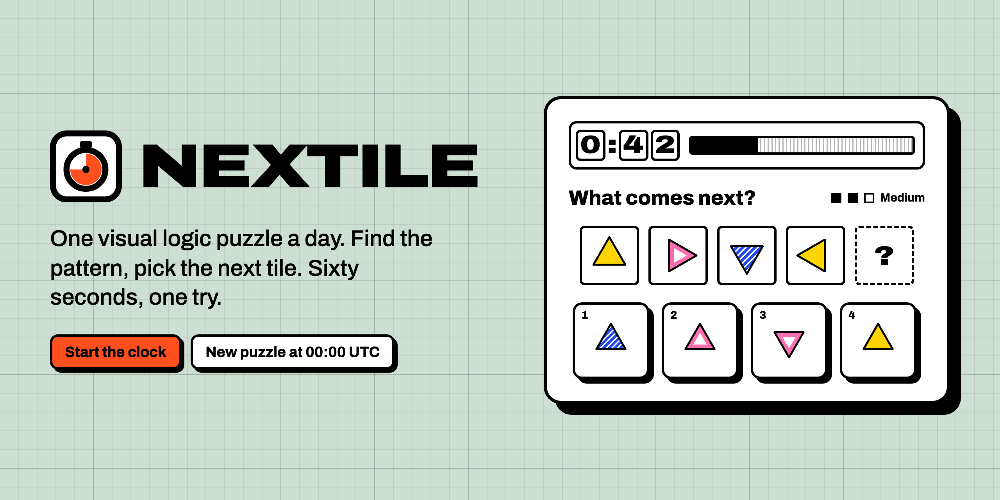
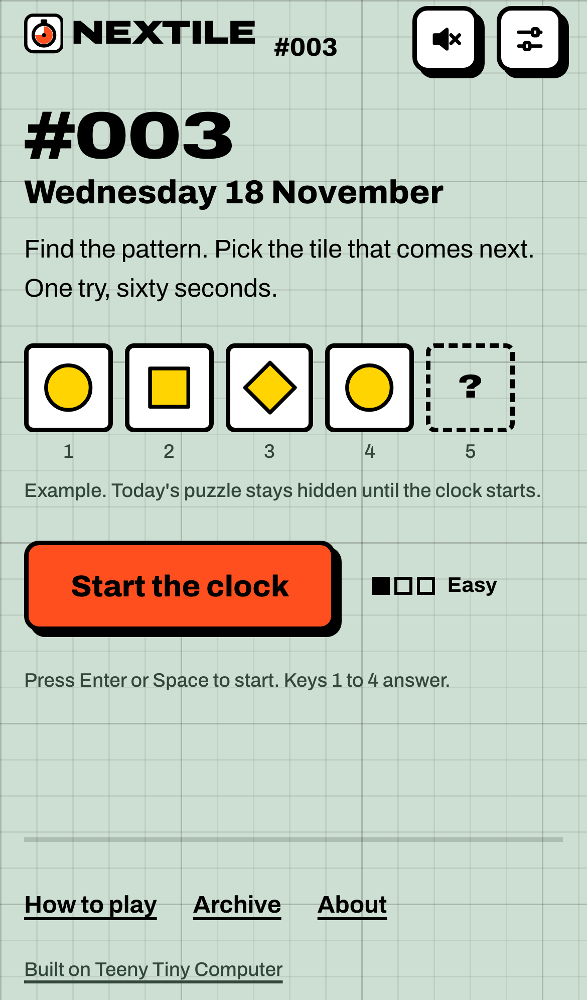
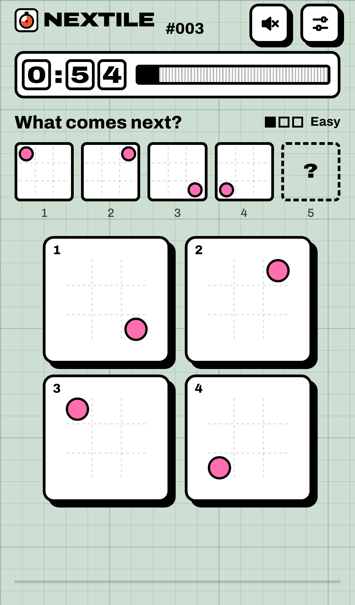
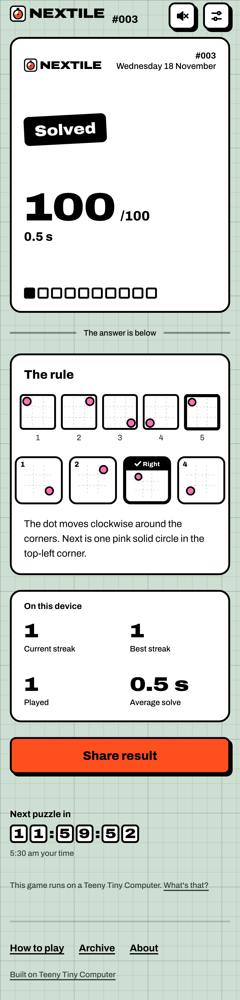
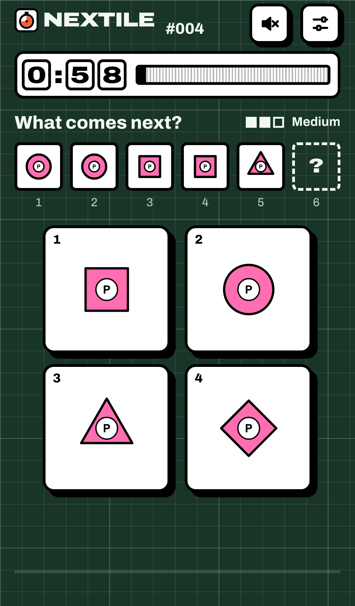

<p align="center">
  
</p>

# Nextile

One visual logic puzzle a day. At 00:00 UTC everyone gets the same short sequence of tiles. Press **Start the clock**, find the rule, and pick the tile that comes next. Sixty seconds, one try. Then see your score, the rule, your streak, and a spoiler-free result to share.

- **Fair by construction.** The tiles reach your browser only when you press Start, the server keeps the official time, and the answer never leaves the server until you've finished.
- **Every puzzle is proven.** Each one is written from a rule, then checked by a solver that looks for every other reading a player might see, so exactly one answer fits. Difficulty is computed from the rule rather than chosen by hand.
- **65 puzzles scheduled** from 16 November 2026 to 19 January 2027, in a weekly rhythm: easy on Monday and Tuesday, medium Wednesday to Friday and on Sunday, hard on Saturday.
- **Plays well everywhere.** Keyboard play (Enter or Space to start, 1–4 to answer), plain-English tile descriptions for screen readers, color assist, reduced motion, and a light and a night "cutting mat" theme.
- **Spoiler-free sharing**, with a per-result link preview that shows the score and never the tiles.
- **One small machine.** Next.js and SQLite, with no external services.

<table>
  <tr>
    <td></td>
    <td></td>
    <td></td>
    <td></td>
  </tr>
</table>

## Quick start

You need Node 22 or newer and pnpm 10 (`corepack enable`).

```sh
pnpm install
pnpm dev                 # http://localhost:3000
```

## Commands

| Task | Command |
|---|---|
| Develop | `pnpm dev` |
| Unit tests (Vitest) | `pnpm test` |
| Browser tests (Playwright, axe) | `pnpm exec playwright install chromium` once, then `pnpm test:e2e` |
| Everything, as CI would run it | `pnpm check` |
| Production build and run | `pnpm build && pnpm start` |
| Validate every puzzle and the schedule | `pnpm validate:puzzles` |
| Build a new puzzle from its rule | `pnpm puzzle:build p-0066` |
| Preview puzzles (ASCII plus an SVG contact sheet) | `pnpm puzzle:preview` |
| Extend the schedule | `pnpm schedule:extend` |
| Freeze published puzzles | `pnpm lock:published` |
| Launch metrics from the database | `pnpm report` |
| Re-render this README's banner | `pnpm banner` |

## Deploying

Nextile runs as a single process with a SQLite file on persistent disk, behind HTTPS. Two ways to do it:

- **Docker:**

  ```sh
  docker build -t nextile --build-arg PUBLIC_ORIGIN=https://nextile.example .
  docker run -d --name nextile --restart unless-stopped -p 127.0.0.1:3000:3000 \
    -v nextile-data:/data -e PUBLIC_ORIGIN=https://nextile.example nextile
  ```

- **A Linux machine** with systemd and Caddy, using the templates in [`deploy/`](deploy).

[docs/DEPLOY.md](docs/DEPLOY.md) has the full guide: configuration, both options step by step, upgrades, backups, health checks and operating notes.

## How it works

1. `GET /api/today` tells the browser what today looks like for it: not launched, no puzzle, ready, in progress, or finished. It never includes tiles.
2. **Start** (`POST /api/attempts`) records the start time on the server and returns the tiles and choices, but not the answer. A refresh resumes the same attempt with the time that's left.
3. The browser runs a deadline-based clock and locks the first answer. It saves the answer locally, then sends it (`POST /api/attempts/:id/finish`) until the server scores it.
4. The server sets the official time: it trusts the browser's measurement only within a 2-second window below its own, and scores the answer as `70 + round(30 × (60 − seconds) ÷ 60)`, or 0 for a miss or a timeout.
5. Results, streaks and stats are derived from history, kept on the device, and restored from the server if local storage is cleared.

The full rules are in [docs/GAME-RULES.md](docs/GAME-RULES.md).

## Project layout

```
app/                    pages, API route handlers, Open Graph images
src/engine/             the puzzle engine: rules, canonical tiles, solver, validator, difficulty, distractors, explanations
src/content/            puzzles (one file each), schedule, publication lock, tutorial
src/game/               state machine, game hook, countdown, keyboard, API client
src/server/             SQLite, attempts, adjudication, player cookie, rate limit, analytics sink
src/persistence/        local storage, migration, streaks and stats
src/ui/                 components and screens
scripts/                puzzle authoring, validation, scheduling, lock, report, banner
tests/                  unit tests (Vitest), browser tests (Playwright), fixtures
deploy/                 systemd unit, Caddyfile, deploy and backup scripts
docs/                   deploy guide, game rules, puzzle authoring, environment, completion report
```

## Docs

- [DEPLOY.md](docs/DEPLOY.md): running it in production
- [GAME-RULES.md](docs/GAME-RULES.md): timing, scoring, streaks and difficulty in plain words
- [PUZZLE-AUTHORING.md](docs/PUZZLE-AUTHORING.md): writing, building, validating, scheduling and freezing puzzles
- [ENVIRONMENT.md](docs/ENVIRONMENT.md): toolchain versions and why they were chosen
- [COMPLETION.md](docs/COMPLETION.md): what was built, deviations from the plan, and what's left
